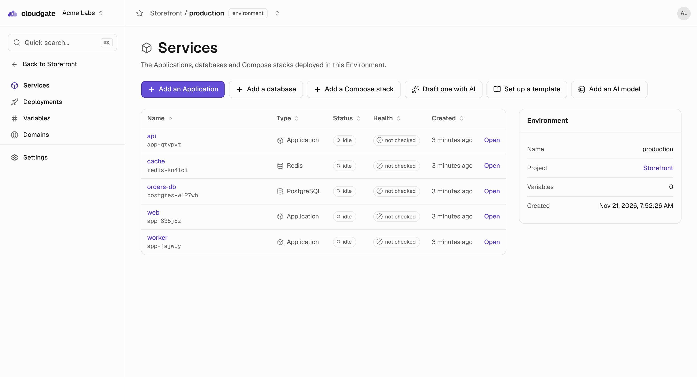
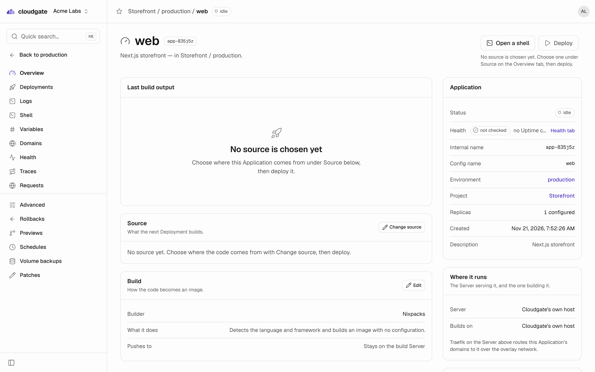
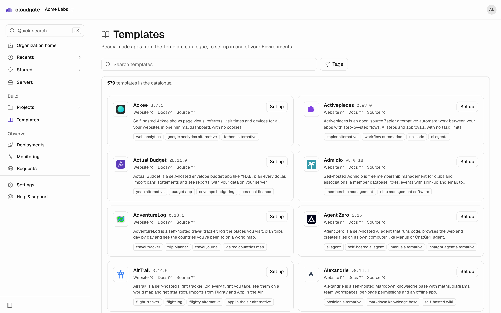
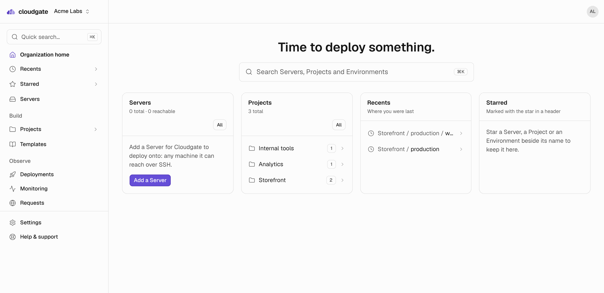
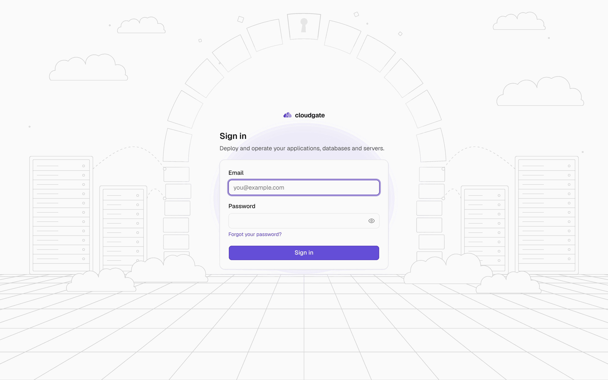

<div align="center">

<picture>
  <source media="(prefers-color-scheme: dark)" srcset="frontend/public/cloudgate-mark-dark.svg">
  
</picture>

# Cloudgate

**Deploy on your own Servers, with the console you'd expect from a hosted platform.**

Cloudgate builds and runs your Applications, databases and Compose stacks on machines you own,
and handles the domains, certificates, backups, metrics and access control around them.

[](https://github.com/octabyte-io/cloudgate/actions/workflows/ci.yml)
[](https://github.com/octabyte-io/cloudgate/actions/workflows/e2e-shards.yml)
[](LICENSE)
[](https://www.npmjs.com/package/@octabyte-io/cloudgate)

[Website](https://cloudgate.octabyte.io) · [Install](#install) · [Features](#features) · [Docs](docs/deploy.md) · [Development](#development)

</div>

<br>

<picture>
  <source media="(prefers-color-scheme: dark)" srcset="docs/images/readme/environment-dark.png">
  
</picture>

## Why Cloudgate

- **Your machines, your data.** Run on the host Cloudgate is installed on, add more Servers over SSH, or deploy into your own AWS or Google Cloud account.
- **One install, no moving parts to assemble.** A single command sets up the console, PostgreSQL, Docker Swarm and a Traefik edge on a bare Ubuntu machine.
- **Push code, get a URL.** Connect a git repository and Cloudgate builds it, deploys it, routes a Domain to it and issues the HTTPS certificate.
- **Built for teams and agents.** Organizations, roles and an audit log for people, and an MCP endpoint so AI agents can operate Cloudgate within the same rules.

## Features

<table>
<tr>
<td width="50%" valign="top">

**Deploy anything**
- Applications from GitHub, GitLab, Bitbucket, Gitea, a Docker image or raw files
- Builds with Nixpacks, Railpack, a Dockerfile, Heroku or Paketo buildpacks, or as a static site
- Workers, cron services and private web services
- Docker Compose stacks
- 570+ ready-made Templates, set up in one click

</td>
<td width="50%" valign="top">

**Managed databases**
- PostgreSQL, MySQL, MariaDB, MongoDB, Redis and libSQL
- Scheduled backups and volume backups to your own storage Destinations
- Buckets for files your Services share
- Variables wired between Services, so connection details stay in sync

</td>
</tr>
<tr>
<td valign="top">

**Ship with confidence**
- Live build and runtime logs, and a shell into any container
- Pull-request previews and on-demand preview deployments
- One-click rollbacks to an earlier Deployment
- Domains with automatic Let's Encrypt certificates, redirects and forward auth

</td>
<td valign="top">

**Operate and observe**
- CPU, memory, disk and network for every Server, streamed live
- Request logs, error rates, traces and uptime checks
- Alerts to Slack, Discord, Teams, Telegram, email, ntfy and more
- Self-hosted AI models behind an OpenAI-compatible gateway

</td>
</tr>
<tr>
<td valign="top">

**Teams and access**
- Organizations, Projects and Environments to keep things separate
- Built-in and custom roles, scoped down to a single Service
- SSO, two-factor sign-in and a full audit log

</td>
<td valign="top">

**Automate it**
- The `cloudgate` CLI to deploy a folder from your terminal or CI
- A REST API with a checked-in OpenAPI schema
- An MCP endpoint for AI agents, with their own keys and limits
- Project config files, reviewed as a plan before they apply

</td>
</tr>
</table>

## A look around

<table>
<tr>
<td width="50%">

<picture>
  <source media="(prefers-color-scheme: dark)" srcset="docs/images/readme/application-dark.png">
  
</picture>

<p align="center"><sub><b>Application overview</b>: source, build and where it runs</sub></p>
</td>
<td width="50%">

<picture>
  <source media="(prefers-color-scheme: dark)" srcset="docs/images/readme/templates-dark.png">
  
</picture>

<p align="center"><sub><b>Templates</b>: hundreds of ready-made apps</sub></p>
</td>
</tr>
<tr>
<td width="50%">

<picture>
  <source media="(prefers-color-scheme: dark)" srcset="docs/images/readme/home-dark.png">
  
</picture>

<p align="center"><sub><b>Organization home</b>: everything you run, one page</sub></p>
</td>
<td width="50%">

<picture>
  <source media="(prefers-color-scheme: dark)" srcset="docs/images/readme/sign-in-dark.png">
  
</picture>

<p align="center"><sub><b>Your own instance</b>: the first sign-up owns it</sub></p>
</td>
</tr>
</table>

<p align="center"><sub>Screenshots show the console in your system's light or dark theme, with sample data.</sub></p>

## How it fits together

```
Organization → Project → Environment → Application / database / Compose stack → deployed onto Servers
```

An **Organization** is your team. A **Project** groups what ships together (say, *Storefront*), and its
**Environments** (*production*, *staging*) hold the Services. Each attempt to build and release one is a
**Deployment**, with its own log. Cloudgate runs everything on **Servers**: the host it is installed on,
or any machine it can reach over SSH. `CONTEXT.md` is the full glossary.

## Install

On a bare Ubuntu 24.04 or 26.04 amd64 machine:

```bash
curl -fsSL https://raw.githubusercontent.com/octabyte-io/cloudgate/main/install.sh | sudo sh
```

That downloads the latest Cloudgate version, prebuilt, checks its sha256, unpacks it at
`/opt/cloudgate` and runs its `deploy/install.sh`: Node under systemd, Postgres on the box, a Swarm
of one, and a Traefik container it owns. Then open the address it prints. **The first sign-up claims
the instance**; everyone after that joins by invitation.

[`docs/deploy.md`](docs/deploy.md) is the operating guide: the origin model, the security posture,
upgrades, instance backup and the known traps. There is no Dockerfile or compose file for Cloudgate
itself; it deploys containers, it does not ship as one.

### Deploy from your terminal

```bash
npm install -g @octabyte-io/cloudgate
cloudgate login --instance cloud.acme.dev   # approve the code in the console
cloudgate --help
```

### Guides

| Guide | What it covers |
| --- | --- |
| [Deploying Cloudgate](docs/deploy.md) | Installing and operating an instance |
| [Linking a database](docs/linking-a-database.md) | Connecting an Application to a database |
| [Linking a bucket](docs/linking-a-bucket.md) | Sharing files between Services |
| [Running a worker](docs/running-a-worker.md) | Always-on Services with no Domain |
| [Running a cron service](docs/running-a-cron-service.md) | Commands on a timetable |
| [Private web services](docs/private-web-services.md) | HTTP reachable only by your other Services |
| [Connecting an agent](docs/connecting-an-agent.md) | The MCP endpoint and its limits |
| [Calling an AI model](docs/calling-an-ai-model.md) | Chat front ends and vector stores through the gateway |

## Development

Cloudgate is one pnpm workspace: a NestJS backend (`backend/`), a Next.js console (`frontend/`) and
the CLI (`cli/`). The backend is a single NestJS application, and the console is written against its API.

### Requirements

- **Node 24** and **pnpm 10.33.2**. The package manager is pinned by `packageManager` in the root `package.json`, so CI and a local clone cannot drift apart. Node is not pinned by an `engines` field; 24 is what CI installs and what this was built and verified on.
- **PostgreSQL.** One database, reached over `DATABASE_URL`.
- **A Docker daemon**, for two unrelated reasons. The product's actual job is to build images and run Swarm services, so a machine that is to deploy anything needs Docker with Swarm initialised. Separately, the backend's e2e suite starts a real Postgres container per run (ADR 0002), so running those tests needs a daemon whether or not you intend to deploy.
- **`nixpacks` on the host**, if you want the default builder to succeed — `backend/src/builders/strategies/nixpacks.strategy.ts` shells out to the binary. Without it the API, the console and every test suite still run, and the Dockerfile and Docker-image strategies still build.

### Local setup

```bash
pnpm install
cp backend/.env.example backend/.env
```

`backend/.env.example` is commented at length and is the thing to read, rather than a summary of it here. Generate the two secrets it leaves blank with `openssl rand -hex 32`. Two of its settings are the ones people get wrong, and both are explained in the file:

- **`BETTER_AUTH_URL` points at the frontend, not at this backend.** The console proxies `/api/auth/*` through its own origin (`frontend/next.config.ts`), better-auth trusts `BETTER_AUTH_URL` for free, and every link it emails is built from that value — so it has to be an origin that actually serves the auth path. Locally it is `http://localhost:3000`. Point it at Nest instead and every browser sign-in is refused with "Invalid origin".
- **`CLOUDGATE_DIRECTORY` defaults to `/etc/cloudgate`, which no ordinary user can create.** It is where the instance keeps its own files: deployment logs, Application and Compose source trees, SSH keys, Traefik config, schedules. Point it somewhere writable and nothing needs sudo to deploy or stream a log (it was made relocatable for exactly that reason) — that is true for a local or hand-rolled backend, which is what this section is about. On a host `deploy/install.sh` provisioned, leave it at the default: the installer's Traefik config resolves three container-read keys through it, so relocating the root there unroutes the edge. Servers you *add* keep their own `/etc/cloudgate`, created by the setup script — this only moves the tree on the host the backend runs on.

`frontend/.env` is optional. Under `pnpm dev`, `CLOUDGATE_API_URL` defaults to `http://localhost:4000`, so a default local setup needs no frontend env file at all (a built console started with `pnpm start` refuses to start without it); `frontend/.env.example` explains what it is for anyway, and why the browser never calls that origin over HTTP — the REST and auth paths are rewritten through the console's own origin so the session cookie stays first-party, and only the six WebSocket gateways are dialled on it directly.

Then apply the schema and start both halves:

```bash
pnpm --filter backend db:migrate   # apply all migrations
pnpm dev                           # backend on :4000, console on :3000
```

**The first sign-up claims the instance.** Until an owner exists, `GET /auth/sign-up-open` answers `{"open":true}` and `/sign-up` renders its form; once one does, uninvited sign-up closes and further accounts arrive by invitation. There is no seed step and no default account.

### Commands

| Command | Notes |
|---|---|
| `pnpm dev` | Both workspaces in parallel. |
| `pnpm dev:backend` | Nest in watch mode on `:4000`, or `PORT`. |
| `pnpm dev:frontend` | Next on `:3000`. |
| `pnpm build` | `nest build` and `next build`. |
| `pnpm -r run typecheck` | `tsc --noEmit` in both workspaces. The backend's covers `src/` **and** `test/`. |
| `pnpm -r run lint` | Check-only in both. `lint:fix` is the mutating one, and the split is deliberate: `lint` used to end in `--fix`, which rewrites the checkout and then reports success on what it just rewrote, so it could not fail and therefore could not gate. |
| `pnpm --filter backend test` | Jest over `backend/test/**/*.spec.ts`. Around 8 seconds. |
| `pnpm --filter backend test:e2e` | `backend/test/**/*.e2e-spec.ts`. Needs a Docker daemon; sizes its workers to the machine — see below. |
| `pnpm --filter frontend test` | Vitest, once through. `test:watch` to stay. |
| `pnpm --filter backend db:generate` | Write a migration from a schema change. |
| `pnpm --filter backend db:migrate` | Apply the committed migrations in `backend/drizzle/`. |
| `pnpm --filter backend openapi:generate` | Rewrite `backend/openapi.json` from the DTOs. It is checked in so a contract change shows up as a diff in review, and CI asserts it is current. |

Two things about those last rows that cost time to work out:

**Let the e2e suite pick its worker count, and set it with `CLOUDGATE_E2E_WORKERS` rather than a flag to the script.** It forks as many workers as the machine has room for, up to 4 (`backend/test/utils/worker-budget.js`). Do not hand it jest's default: at 9 workers on a 10-core, 16 GB machine the run did not merely slow down, it *failed*: 18 of 79 suites died with `Right-hand side of 'instanceof' is not an object`, which is starvation rather than a fault — every one of them passes alone. A `--maxWorkers` flag cannot be threaded through the script, because `pnpm run … -- --maxWorkers=2` reaches jest behind a literal `--` and is read as a test path pattern, so the run finds no tests at all. Use the variable, or call jest directly:

```bash
CLOUDGATE_E2E_WORKERS=2 pnpm --filter backend test:e2e
pnpm --filter backend exec jest --config ./test/jest-e2e.json --maxWorkers=2
```

**Prefer `db:migrate` to `db:push` on any database you intend to keep.** A push writes the column and no journal row, so a later `db:migrate` reaches a migration whose `ALTER TABLE … ADD COLUMN` has already happened — and drizzle-kit reports that by exiting 1 with nothing at all on stdout or stderr. It is an easy state to reach and a confusing one to diagnose.

### What CI runs

`.github/workflows/ci.yml` runs two jobs on every push to `main` and every pull request.

- **Type-check and lint**: `pnpm -r run typecheck`, `pnpm -r run lint` and `bash -n deploy/install.sh`.
- **Unit lanes**: `pnpm --filter backend test` and `pnpm --filter frontend test`. The backend lane carries every census gate in `backend/test/coding-standards/` and the assertion that `backend/openapi.json` still matches what the DTOs generate. The frontend lane carries the console's tests and the custom eslint rules' own.

**It does not run the e2e suite or `test:db`; `.github/workflows/e2e-shards.yml` does.** On every push to `main`, every `build/**` branch and every pull request, it splits the e2e suite across eight runners and runs `test:db` beside them, and its `E2E` check is green only when all of them are. A red suite is re-run alone first, so only a suite red alone too (or a wedged run) fails it. `/build` and `/fix` wait for that check on their pull request, then merge it.

### Repo layout

```
backend/                   NestJS API, WebSocket gateways, the deploy engine and the job queue
  src/                     one directory per feature; users/ is the template
  drizzle/                 committed migrations
  test/                    *.spec.ts and Testcontainers-backed *.e2e-spec.ts, side by side
  openapi.json             generated, checked in, asserted current by CI
frontend/                  Next 16 App Router, Tailwind v4, shadcn base-nova
  src/app/                 (auth) outside the console shell, (console) inside it, dev/ galleries
  src/components/          ui/ is shadcn's and never forked; console/ and shell/ are ours
  src/features/            one directory per scope — the panels the tab registry mounts
  src/lib/                 API client, auth client, query keys, design tokens, formatters
  src/proxy.ts             the optimistic session gate — Next 16's rename of middleware.ts
  docs/design-system.md    the component index; read it before writing a component
cli/                       the Cloudgate CLI (`@octabyte-io/cloudgate` on npm)
deploy/                    install.sh and the systemd units for a native install
install.sh                 the one-command install: downloads a Cloudgate version, runs its deploy/install.sh
CONTEXT.md                 the glossary
CODING_STANDARDS.md        the conventions a review checks
CHANGELOG.md               what changed for an operator, release by release
docs/deploy.md             installing and operating Cloudgate on a server
docs/testing.md            running the test lanes, and what to do when one fails or hangs
docs/adr/                  the architecture decisions, one file each
docs/aws-walk-by-hand.md   the release check against a real AWS account that no suite can make
docs/gcp-walk-by-hand.md   the same check against a real Google Cloud project
docs/connecting-an-agent.md  the MCP endpoint, its header, and the limits an Agent works within
docs/calling-an-ai-model.md  wiring a chat front end or a vector store to an AI model through the gateway
docs/linking-a-database.md, linking-a-bucket.md, running-a-worker.md, running-a-cron-service.md,
private-web-services.md    operator guides for each kind of Service
```

### Where the decisions are recorded

Every architecture decision is a short record in `docs/adr/`: the decision, the alternatives that
were rejected, and why. Read the ones that touch the area you are changing before you change it.
`CONTEXT.md` is the vocabulary those records and the code are written in.

## Contributing and security

Bug reports and feature ideas are welcome as GitHub issues; see [`CONTRIBUTING.md`](CONTRIBUTING.md) for
how to set up, test and send a change. Please do not report a security problem in a public issue:
[`SECURITY.md`](SECURITY.md) says how to report one privately.

## License

Cloudgate is source-available under the [Elastic License 2.0](LICENSE) (ELv2). Anyone, individual or
business, may use, self-host and modify it for free. You may not offer Cloudgate to others as a hosted
or managed service, and you may not remove, disable or work around the license-key checks that
protect its paid features. The license text is the authority; this summary is not.
